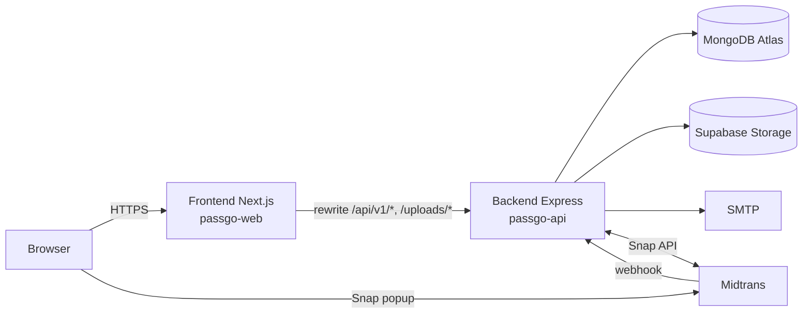
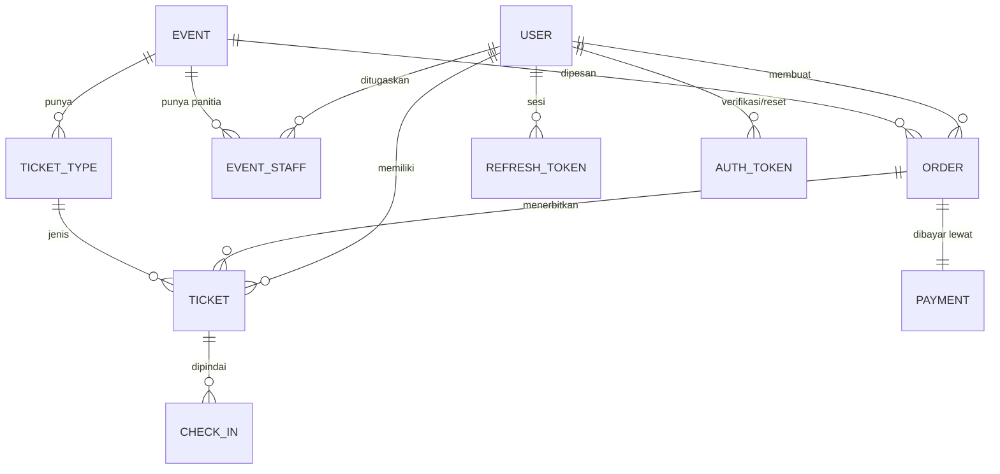
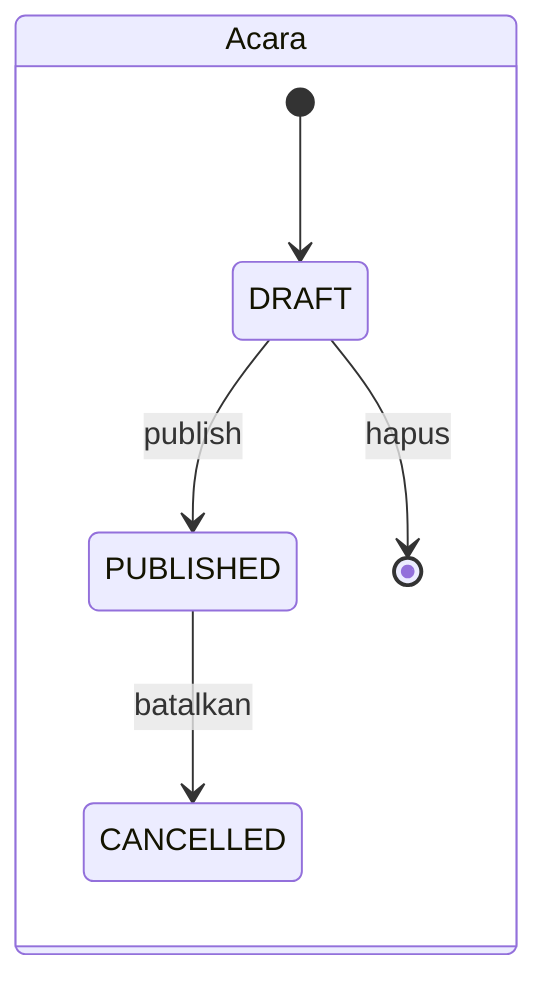
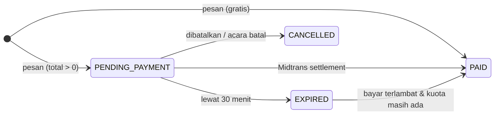
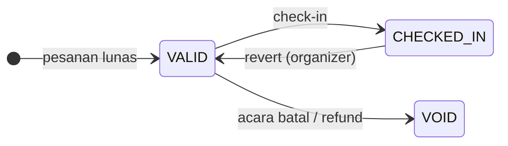
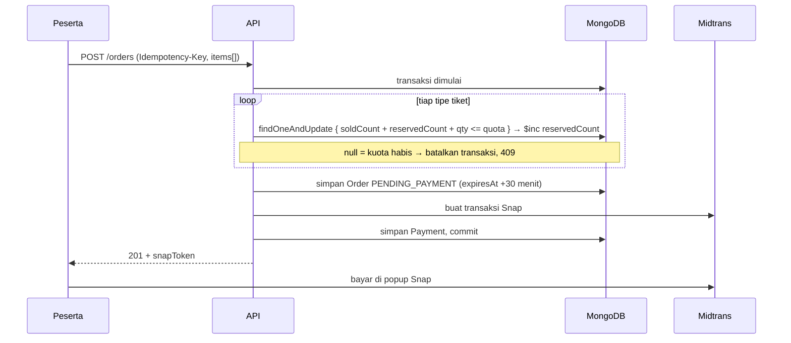

# PassGo — Dokumentasi Lengkap Proyek

> Satu dokumen ringkas untuk memahami seluruh repository: produk, pengguna, fitur, arsitektur, data, endpoint,
> halaman, keamanan, pengujian, dan deploy. Detail teknis penuh tetap ada di dokumen sumber:
> [`api-contract.md`](api-contract.md) (kontrak REST) dan [`architecture.md`](architecture.md) (arsitektur).
>
> Terakhir diperbarui: 17 November 2026 · Commit `main` 88f0931

---

## Daftar isi

1. [Ringkasan](#1-ringkasan)
2. [Tim](#2-tim)
3. [Latar belakang & masalah](#3-latar-belakang--masalah)
4. [Aktor & hak akses](#4-aktor--hak-akses)
5. [User story](#5-user-story)
6. [Fitur](#6-fitur)
7. [Tech stack](#7-tech-stack)
8. [Arsitektur](#8-arsitektur)
9. [Struktur repository](#9-struktur-repository)
10. [Model data](#10-model-data)
11. [Status & state machine](#11-status--state-machine)
12. [Alur bisnis utama](#12-alur-bisnis-utama)
13. [Konvensi API](#13-konvensi-api)
14. [Daftar endpoint](#14-daftar-endpoint)
15. [Halaman frontend](#15-halaman-frontend)
16. [Keamanan](#16-keamanan)
17. [Pengujian](#17-pengujian)
18. [Menjalankan secara lokal](#18-menjalankan-secara-lokal)
19. [Deploy](#19-deploy)
20. [Environment variable](#20-environment-variable)
21. [Keputusan desain (ADR)](#21-keputusan-desain-adr)
22. [Roadmap & di luar lingkup](#22-roadmap--di-luar-lingkup)

---

## 1. Ringkasan

**PassGo** adalah platform tiket acara untuk komunitas kreatif yang rutin menggelar workshop, pertunjukan kecil,
dan pasar seni (puluhan sampai beberapa ratus peserta per acara). PassGo menggantikan alur lama
*formulir online → transfer manual → konfirmasi lewat WhatsApp → daftar hadir manual*.

Tiga janji utama:

| Janji | Caranya |
|---|---|
| Kuota **tidak pernah terlampaui**, walau banyak orang membeli bersamaan | Kuota direservasi secara atomik di MongoDB saat pesanan dibuat |
| Pembayaran **otomatis lunas** tanpa bukti transfer | Midtrans Snap + webhook bertanda tangan |
| Masuk acara **cepat dan aman** | Tiap tiket punya kode QR unik acak; check-in atomik sehingga satu tiket hanya bisa masuk sekali |

| | |
|---|---|
| Website | https://passgo-web.azurewebsites.net |
| API | https://passgo-api.azurewebsites.net/api/v1 |
| Repository | https://github.com/gadicandra/PassGo |
| Referensi produk | Loket.com, GoTix, Tiket.com |

---

## 2. Tim

Kelompok 10 · Pengembangan Aplikasi Web · Teknologi Informasi UGM.

| Anggota | Tanggung jawab Milestone 2 (frontend) |
|---|---|
| Marcelinus Dinoglide Yoga Prakoso | Scaffold frontend, komponen bersama, katalog, detail acara, checkout + Midtrans Snap, pesanan, pesanan organizer |
| Garjita Adicandra | Lapisan data (API client, refresh token, guard peran), auth (masuk, daftar, verifikasi, reset), profil, kelola pengguna, log audit, deploy, README |
| Rasyid Rayhan Novandy | Tiket saya + QR, ubah nama pemegang, scanner QR panitia, daftar peserta, check-in, ekspor, laporan kehadiran |
| Debert Jamie Chanderson | Kelola acara organizer (acara, tipe tiket, poster, panitia, laporan penjualan) |

Milestone 1 (backend API v1) dikerjakan bersama.

---

## 3. Latar belakang & masalah

| Masalah | Akar masalah | Jawaban PassGo |
|---|---|---|
| Kuota terlampaui (*overselling*) | Pembayaran dan pencatatan slot terpisah; tidak ada penguncian kuota | Kuota direservasi atomik saat pesanan dibuat; pembayaran hanya untuk slot yang sudah direservasi |
| Panitia kewalahan mengecek bukti transfer | Verifikasi manual | Payment gateway (Midtrans Snap) + webhook: pesanan otomatis lunas |
| Daftar hadir disusun manual | Data pembeli tercecer di chat | Daftar peserta terbentuk otomatis dari tiket yang terbit; bisa diekspor CSV/XLSX |
| Validasi di pintu lambat, rawan tiket palsu / dipakai dua kali | Tiket tidak punya identitas unik | Kode tiket acak (QR) + check-in atomik |

---

## 4. Aktor & hak akses

| Aktor | Peran | Cara mendapat akun |
|---|---|---|
| **Tamu** | Melihat katalog acara yang dipublikasikan | Tidak perlu akun |
| **Peserta** (`ATTENDEE`) | Membeli tiket, melihat pesanan dan e-ticket miliknya | Daftar mandiri (email/password atau Google) + verifikasi email |
| **Panitia** (`STAFF`) | Memindai tiket dan melihat peserta di acara yang **ditugaskan** kepadanya | Dibuat organizer, lalu ditugaskan per acara |
| **Penyelenggara** (`ORGANIZER`) | Mengelola acara, tipe tiket, panitia, pesanan, laporan, akun, audit | Akun pertama dari seed; berikutnya disetujui superadmin atau dibuat organizer lain |
| **Superadmin** | Meninjau pengajuan penyelenggara baru | Penanda pada akun organizer, hanya diatur lewat skrip server (`scripts/set-superadmin.ts`) |

### Matriks wewenang

| Kapabilitas | Tamu | Peserta | Panitia | Organizer |
|---|:-:|:-:|:-:|:-:|
| Lihat acara `PUBLISHED`/`CANCELLED` & tipe tiketnya | ✅ | ✅ | ✅ | ✅ |
| Lihat acara `DRAFT`; kelola acara, tipe tiket, poster | ❌ | ❌ | ❌ | ✅ |
| Tugaskan panitia ke acara | ❌ | ❌ | ❌ | ✅ |
| Beli tiket, lihat & batalkan pesanan sendiri | ❌ | ✅ | ❌ | ❌ |
| Lihat tiket & QR sendiri, ubah nama pemegang, kirim ulang email | ❌ | ✅ | ❌ | ❌ |
| Lihat daftar peserta | ❌ | ❌ | ⚠️ acara ditugaskan, data pembeli di-*mask* | ✅ |
| Check-in (pindai QR / manual) | ❌ | ❌ | ⚠️ acara ditugaskan | ✅ |
| Batalkan check-in, terbitkan ulang kode tiket | ❌ | ❌ | ❌ | ✅ |
| Laporan kehadiran | ❌ | ❌ | ⚠️ acara ditugaskan | ✅ |
| Semua pesanan, refund, laporan penjualan, ekspor, akun, audit log | ❌ | ❌ | ❌ | ✅ |

Prinsip otorisasi:

1. **Tingkat route**: `authorize('ORGANIZER')`, dsb. Peran dibaca dari database tiap request (bukan dari klaim JWT),
   sehingga menonaktifkan akun atau mengubah peran berlaku seketika.
2. **Tingkat resource** (di service): peserta hanya melihat pesanan/tiket miliknya; panitia hanya acara yang
   ditugaskan. Pelanggaran dijawab **404, bukan 403**, agar keberadaan resource tidak bocor.
3. **Aturan global**: harus selalu ada minimal satu organizer aktif.

---

## 5. User story

### Tamu
- **US-01** Sebagai tamu, saya ingin melihat daftar acara yang sedang dibuka beserta tanggal, lokasi, dan harga mulai, agar saya bisa memilih acara yang menarik.
- **US-02** Sebagai tamu, saya ingin membuka detail acara (deskripsi, poster, tipe tiket, sisa kuota), agar saya tahu apakah tiket masih tersedia.
- **US-03** Sebagai tamu, saya ingin mendaftar akun dengan nama, email, dan nomor HP, agar saya bisa membeli tiket.

### Peserta
- **US-04** Sebagai peserta, saya ingin memverifikasi email saya, agar e-ticket dikirim ke alamat yang benar.
- **US-05** Sebagai peserta, saya ingin login, logout, dan mereset password yang terlupa, agar akun saya tetap aman.
- **US-06** Sebagai peserta, saya ingin melihat dan mengubah profil saya.
- **US-07** Sebagai peserta, saya ingin memesan satu atau beberapa tipe tiket sekaligus, agar saya bisa membeli untuk teman.
- **US-08** Sebagai peserta, saya ingin kuota yang saya pesan ditahan selama saya membayar, agar tiket tidak direbut orang lain di tengah pembayaran.
- **US-09** Sebagai peserta, saya ingin langsung mendapat tiket untuk acara gratis tanpa proses pembayaran.
- **US-10** Sebagai peserta, saya ingin membayar lewat QRIS/e-wallet/VA dan pesanan otomatis lunas tanpa mengirim bukti transfer.
- **US-11** Sebagai peserta, saya ingin melihat riwayat pesanan dan membatalkan pesanan yang belum dibayar.
- **US-12** Sebagai peserta, saya ingin melihat e-ticket berkode QR milik saya dan mengubah nama pemegang tiket, agar teman yang saya belikan bisa masuk.
- **US-13** Sebagai peserta, saya ingin menerima e-ticket lewat email dan bisa meminta kirim ulang.

### Panitia
- **US-14** Sebagai panitia, saya ingin melihat acara yang ditugaskan kepada saya.
- **US-15** Sebagai panitia, saya ingin memindai QR tiket dan langsung tahu apakah tiket valid, sudah dipakai, batal, atau milik acara lain.
- **US-16** Sebagai panitia, saya ingin melakukan check-in manual dari daftar peserta bila QR tidak terbaca.
- **US-17** Sebagai panitia, saya ingin melihat daftar peserta dan jumlah yang sudah hadir di acara yang saya jaga.

### Penyelenggara
- **US-18** Sebagai penyelenggara, saya ingin membuat acara sebagai draf, mengubahnya, lalu mempublikasikannya ketika sudah siap.
- **US-19** Sebagai penyelenggara, saya ingin mengunggah poster acara.
- **US-20** Sebagai penyelenggara, saya ingin membuat beberapa tipe tiket (Presale, Reguler, VIP) dengan harga, kuota, dan jendela penjualan masing-masing.
- **US-21** Sebagai penyelenggara, saya ingin membuat akun panitia dan menugaskannya ke acara tertentu saja.
- **US-22** Sebagai penyelenggara, saya ingin melihat semua pesanan dan mencatat refund.
- **US-23** Sebagai penyelenggara, saya ingin membatalkan acara, dan semua tiket otomatis batal serta pembeli diberi tahu.
- **US-24** Sebagai penyelenggara, saya ingin membatalkan check-in yang keliru dan menerbitkan ulang kode tiket yang hilang/bocor.
- **US-25** Sebagai penyelenggara, saya ingin mengekspor daftar peserta (CSV/XLSX) serta melihat laporan penjualan dan kehadiran.
- **US-26** Sebagai penyelenggara, saya ingin melihat jejak audit perubahan penting.

Sumber: Laporan Milestone 1 (`docs/laporan/`).

---

## 6. Fitur

| No | Fitur | Deskripsi | User story |
|---|---|---|---|
| F1 | Autentikasi & akun | Daftar peserta, login email/password **dan Google**, verifikasi email, refresh token berotasi, logout / logout semua perangkat, lupa & reset password | US-03, 04, 05 |
| F2 | Profil | Lihat & ubah nama/HP, ganti password, kirim ulang verifikasi, acara yang ditugaskan (panitia) | US-06, 14 |
| F3 | Manajemen pengguna | Organizer membuat akun panitia/penyelenggara, mencari, memfilter, mengubah peran, menonaktifkan | US-21 |
| F4 | Manajemen acara | Acara `DRAFT → PUBLISHED → CANCELLED`, slug publik, upload poster (Supabase Storage, diubah ke WebP) | US-01, 02, 18, 19 |
| F5 | Tipe tiket | Banyak tipe per acara: harga, kuota, jendela penjualan, maksimum per pesanan; total kuota ≤ kapasitas | US-02, 20 |
| F6 | Penugasan panitia | Organizer menugaskan / mencabut panitia per acara | US-21 |
| F7 | Pemesanan & reservasi kuota | Pesanan multi-item, reservasi atomik, kuota ditahan 30 menit, validasi harga (`expectedUnitPrice`), satu pesanan menggantung per acara | US-07, 08, 11 |
| F8 | Tiket gratis | Pesanan bertotal Rp0 langsung `PAID`, tiket langsung terbit | US-09 |
| F9 | E-ticket QR | Kode acak 80-bit (`7K2M-9XDQ-4R8B-3N5P`), QR `PASSGO1:<kode>`, ubah nama pemegang, terbitkan ulang kode | US-12, 24 |
| F10 | Check-in | Pindai QR (kamera) atau manual; hasil `ACCEPTED`, `ALREADY_CHECKED_IN`, `TICKET_VOID`, `WRONG_EVENT`, `NOT_FOUND`, `CHECK_IN_CLOSED`; revert oleh organizer | US-15, 16, 24 |
| F11 | Daftar peserta | Daftar tiket per acara dengan filter, pencarian, jumlah hadir; data pembeli di-*mask* untuk panitia | US-17 |
| F12 | Pembayaran Midtrans Snap | QRIS, e-wallet, VA, kartu; webhook SHA-512; sinkron status; kedaluwarsa otomatis; pencatatan refund | US-10, 22 |
| F13 | Email e-ticket | Email lewat outbox dengan QR tertanam; kirim ulang (maks 3×/jam) | US-13 |
| F14 | Pembatalan acara | Pesanan pending batal, tiket `VOID`, penanda refund, email ke pembeli | US-23 |
| F15 | Ekspor & laporan | Ekspor peserta CSV/XLSX, laporan penjualan dan kehadiran | US-25 |
| F16 | Audit log | Jejak perubahan penting (akun, acara, tipe tiket, panitia, pesanan, refund, check-in, ekspor) | US-26 |

Fitur tambahan di frontend: pencarian dengan saran kategori & acara terdekat, filter katalog (minggu ini, bulan ini,
gratis, kategori), **acara disimpan** (bookmark lokal), tambah ke kalender (Google / `.ics`), bagikan acara
(salin tautan, WhatsApp, X, Facebook), tampilan HP dengan bilah navigasi bawah.

---

## 7. Tech stack

| Lapisan | Teknologi | Catatan |
|---|---|---|
| Frontend | **Next.js 16** (App Router, React 19), **Tailwind CSS 4** | `output: "standalone"`; ikon `lucide-react`; QR `qrcode`; pemindai `jsqr` |
| Backend | **Node.js ≥ 22.18**, **Express 5**, TypeScript | Validasi **Zod 4**; log `pino` |
| Database | **MongoDB Atlas** + Mongoose 8 | Wajib *replica set* (transaksi multi-dokumen) |
| Auth | JWT HS256 (access 15 menit) + refresh token opak di cookie HttpOnly | Password `bcryptjs`; login Google (Google Identity Services) |
| Pembayaran | **Midtrans Snap** (sandbox) | Webhook SHA-512 |
| Email | Nodemailer (SMTP), lewat *outbox* | Mailpit saat development |
| Storage | **Supabase Storage** | Poster di-*re-encode* WebP dengan `sharp`; fallback disk lokal |
| Keamanan | `helmet`, `express-rate-limit`, CSP di Next | |
| Ekspor | `exceljs` (XLSX), CSV | |
| Pengujian | `node:test` + `supertest`, Postman/Newman, Playwright (QA) | |
| Deploy | **Azure App Service** (Linux, Node 22) via **GitHub Actions** | Vercel masih didukung (`server.ts`, `vercel.json`) |
| Monorepo | npm workspaces (`apps/backend`, `apps/frontend`) | |

---

## 8. Arsitektur



- **Satu origin untuk browser.** Next.js meneruskan `/api/v1/*` ke backend, sehingga cookie refresh
  `SameSite=Strict` tetap berfungsi. Alamat backend (`BACKEND_URL`) dikunci saat build.
- **Backend berlapis:** `routes` (Zod + otorisasi) → `services` (logika bisnis + transaksi) → `models` (Mongoose).
  Folder `controllers/`, `jobs/`, `config/` disiapkan tapi kosong; route memanggil service langsung.
- **Dua entrypoint, satu app:** `src/index.ts` (server long-running: lokal & Azure, menjalankan job berkala)
  dan `server.ts` (fungsi Vercel). Keduanya memakai `src/app.ts` yang sama, yang juga diekspor untuk test.
- **Job latar:** kedaluwarsa pesanan & pengiriman email outbox dijalankan tiap `JOB_INTERVAL_SECONDS` di server
  long-running, atau lewat `/api/v1/internal/jobs/:job` (Vercel Cron). Keduanya aman berjalan bersamaan.

---

## 9. Struktur repository

```
PassGo/
├── apps/
│   ├── backend/                     # Express API
│   │   ├── server.ts                # entrypoint Vercel
│   │   ├── src/
│   │   │   ├── app.ts               # Express app (dipakai server, Vercel, test)
│   │   │   ├── index.ts             # server long-running + job berkala
│   │   │   ├── routes/              # auth, me, users, events, orders, payments, tickets, audit-logs, jobs
│   │   │   ├── services/            # logika bisnis (order, payment, check-in, email, report, ...)
│   │   │   ├── models/              # skema Mongoose
│   │   │   ├── middlewares/         # authenticate, authorize, rate-limit, error-handler, request-context
│   │   │   ├── validators/          # field bersama (password, phone) + locale Zod Indonesia
│   │   │   ├── lib/                 # database, midtrans, storage, auth-tokens, google-id-token
│   │   │   └── utils/               # AppError, if-match, cursor, ticket-code, uuid
│   │   ├── scripts/                 # seed-organizer, seed-demo-events
│   │   └── tests/                   # unit/ (17 berkas), integration/ (3 berkas, butuh MongoDB)
│   └── frontend/                    # Next.js
│       ├── next.config.ts           # rewrite API, CSP & header keamanan, standalone
│       └── src/
│           ├── app/                 # halaman (route group (site) + scan/)
│           ├── components/          # ui/, layout/, event/, auth/, checkin/, organizer/
│           ├── lib/                 # api.ts (klien API), auth.tsx, format, status, ...
│           └── types/api.ts         # tipe sesuai kontrak
├── docs/                            # kontrak API, arsitektur, desain, deploy Azure, laporan
├── postman/                         # koleksi 87 request / 17 folder + runner Newman
├── .github/workflows/               # deploy-backend.yml, deploy-frontend.yml
└── package.json                     # npm workspaces + skrip root
```

---

## 10. Model data



| Koleksi | Isi penting |
|---|---|
| `User` | nama, email (unik, huruf kecil), phone `+62…`, `passwordHash`, `role`, `isActive`, `emailVerified`, `tokenVersion`, `version` |
| `Event` | `slug`, judul, deskripsi, tempat & alamat, `startAt`/`endAt`, `timezone`, `posterUrl`, `status`, `capacity`, `maxTicketsPerUser`, `checkInOpensAt`, `version` |
| `TicketType` | nama, harga (integer Rupiah), `quota`, `soldCount`, `reservedCount`, jendela penjualan, `maxPerOrder`, `isActive`, `version` |
| `EventStaff` | penugasan panitia ke acara |
| `Order` | `orderNumber` (`PG-XXXXXXXXXX`), `items[]` (embedded), total, `status`, `refundStatus`, `expiresAt`, data pembeli, `ticketEmailStatus` |
| `Payment` | Midtrans: `snapToken`, `redirectUrl`, status, tipe pembayaran, waktu settlement |
| `Ticket` | `code` (unik), `holderName`, `ownerId`, `status`, `voidReason`, `checkedInAt`, `version` |
| `CheckIn` | log setiap pindaian: hasil, metode, pemindai, revert |
| `RefreshToken` | hash token, `familyId`, rotasi (`replacedById`, `revokedAt`) |
| `AuthToken` | token verifikasi email & reset password (hash, sekali pakai) |
| `EmailOutbox` | antrean email: tipe, payload, status, percobaan, `nextAttemptAt` |
| `IdempotencyKey` | respons tersimpan untuk `Idempotency-Key` (24 jam) |
| `AuditLog` | aktor, aksi, entitas, nilai sebelum/sesudah, IP, user agent |

Semua ID adalah **UUID v7** di field `id` (bukan `_id`). Uang selalu **integer Rupiah**.

---

## 11. Status & state machine

| Enum | Nilai |
|---|---|
| `User.role` | `ORGANIZER`, `STAFF`, `ATTENDEE` |
| `Event.status` | `DRAFT`, `PUBLISHED`, `CANCELLED` |
| `salesStatus` (diturunkan) | `UPCOMING`, `ON_SALE`, `SOLD_OUT`, `PAUSED`, `ENDED` |
| `Order.status` | `PENDING_PAYMENT`, `PAID`, `EXPIRED`, `CANCELLED` |
| `Order.refundStatus` | `NOT_REQUIRED`, `REQUIRED`, `REFUNDED` |
| `Order.ticketEmailStatus` | `NOT_APPLICABLE`, `PENDING`, `SENT`, `FAILED` |
| `Ticket.status` | `VALID`, `CHECKED_IN`, `VOID` |
| `Ticket.voidReason` | `EVENT_CANCELLED`, `ORDER_REFUNDED` |
| `CheckIn.method` / `result` | `QR`, `MANUAL` / `ACCEPTED`, `ALREADY_CHECKED_IN`, `TICKET_VOID`, `WRONG_EVENT`, `NOT_FOUND`, `CHECK_IN_CLOSED` |







Aturan penting:
- **Publish** butuh deskripsi, alamat, `startAt` di masa depan, minimal satu tipe tiket aktif, dan total kuota
  tidak melebihi kapasitas acara.
- Acara hanya bisa **dihapus** selagi `DRAFT`; tipe tiket hanya bisa dihapus bila belum pernah dipesan, dan
  kuota tidak boleh diturunkan di bawah tiket yang sudah terjual atau dipesan.
- Satu peserta hanya boleh punya **satu pesanan menggantung** per acara.
- Check-in diputuskan oleh **satu operasi atomik** `{ code, eventId, status: 'VALID' }`, jadi dua pindaian
  bersamaan menghasilkan tepat satu yang diterima.

---

## 12. Alur bisnis utama

### Pesan tiket & reservasi kuota (inti anti-overselling)



### Pembayaran → tiket terbit

1. Midtrans mengirim webhook ke `POST /payments/midtrans/notifications`.
2. API memverifikasi tanda tangan SHA-512 dan nominal, lalu mengonfirmasi ulang status ke Midtrans.
3. Dalam satu transaksi: pesanan `PAID`, `reservedCount → soldCount`, tiket diterbitkan (kode acak),
   email e-ticket dimasukkan ke outbox.
4. Outbox dikirim (langsung setelah request, atau oleh job berkala) dengan QR tertanam.

### Check-in

Panitia memindai QR → `POST /events/:eventId/check-ins` → satu update atomik menentukan hasil
(`ACCEPTED`, `ALREADY_CHECKED_IN`, dst.) → semua pindaian dicatat di `CheckIn`.

### Pembatalan acara

Pesanan pending dibatalkan, tiket `VOID`, pesanan lunas ditandai `REQUIRED` refund, email pemberitahuan dikirim.
Refund dilakukan manual oleh organizer lalu dicatat lewat `POST /orders/:orderId/refund`.

---

## 13. Konvensi API

| Aspek | Aturan |
|---|---|
| Base path | `/api/v1` |
| Format | JSON, `camelCase`; ID UUID v7; uang integer Rupiah; waktu RFC 3339 UTC |
| Envelope sukses | `{ "data": …, "meta": { … } }` |
| Error | RFC 9457 `application/problem+json` dengan `code` (untuk logika FE) dan `detail` (Bahasa Indonesia) |
| Auth | `Authorization: Bearer <accessToken>`; refresh lewat cookie `__Secure-refresh_token` |
| CSRF | `/auth/refresh` & `/auth/logout` wajib `Origin` terdaftar + `X-Requested-With: fetch` |
| Idempotency | Endpoint 🔁 wajib `Idempotency-Key: <uuid>`; respons disimpan 24 jam |
| Concurrency | Endpoint 🔒 wajib `If-Match: "<version>"` (atau `X-If-Match`); tidak cocok → `412` dengan `current` |
| Pagination | Offset (`page`, `pageSize`) untuk users/events/attendees; cursor (`limit`, `cursor`) untuk orders/tickets/check-ins/audit-logs |
| Field asing | Ditolak `422` (mencegah *mass assignment*) |
| Rate limit | Header `RateLimit` / `RateLimit-Policy`; terlampaui → `429` + `Retry-After` |

Legenda akses di tabel berikut: 🔓 publik · 🍪 cookie refresh + CSRF · 👤 login · 🎟️ peserta ·
🧑‍💼 organizer **atau** panitia yang ditugaskan · 👑 organizer · ⭐ superadmin · 🔏 tanda tangan Midtrans ·
🔁 butuh `Idempotency-Key` · 🔒 butuh `If-Match`.

---

## 14. Daftar endpoint

Semua path di bawah `/api/v1`. Daftar ini diambil dari route Express yang benar-benar terdaftar: **63 endpoint**, ditambah 2 endpoint internal untuk job.

### Health
| Method | Path | Akses | Fungsi |
|---|---|---|---|
| GET | `/health` | 🔓 | Liveness (tanpa DB) |
| GET | `/health/ready` | 🔓 | Readiness, cek koneksi database |

### Auth
| Method | Path | Akses | Fungsi |
|---|---|---|---|
| POST | `/auth/register` | 🔓 | Daftar peserta; selalu `202` (anti enumerasi email) |
| POST | `/auth/login` | 🔓 | Login email/password → access token + cookie refresh |
| POST | `/auth/google` | 🔓 | Login dengan Google (ID token Google Identity Services) |
| POST | `/auth/refresh` | 🍪 | Tukar refresh token (dirotasi) dengan access token baru |
| POST | `/auth/logout` | 🍪 | Cabut refresh token sesi ini |
| POST | `/auth/logout-all` | 👤 | Cabut semua sesi di semua perangkat |
| POST | `/auth/email-verification` | 👤 | Kirim ulang email verifikasi |
| POST | `/auth/email-verification/confirm` | 🔓 | Konfirmasi token verifikasi email |
| POST | `/auth/password-reset` | 🔓 | Minta tautan reset password; selalu `202` |
| POST | `/auth/password-reset/confirm` | 🔓 | Set password baru dengan token reset; mencabut semua sesi |

### Me (akun sendiri)
| Method | Path | Akses | Fungsi |
|---|---|---|---|
| GET | `/me` | 👤 | Data akun sendiri |
| PATCH | `/me` | 👤 🔒 | Ubah nama dan nomor HP |
| POST | `/me/password` | 👤 | Ganti password; sesi lain dicabut, sesi ini tetap |
| POST | `/me/organizer-request` | 👤 | Peserta mengajukan diri menjadi penyelenggara (email terverifikasi, tanpa pembelian aktif) |
| GET | `/me/assigned-events` | 👤 | Acara yang ditugaskan (panitia), `when=upcoming\|past\|all` |

### Users
| Method | Path | Akses | Fungsi |
|---|---|---|---|
| GET | `/users` | 👑 | Daftar pengguna; filter `role`, `isActive`, `q`; urut `name`/`createdAt` |
| POST | `/users` | 👑 🔁 | Buat akun panitia/penyelenggara |
| GET | `/users/:userId` | 👑 | Detail pengguna |
| PATCH | `/users/:userId` | 👑 🔒 | Ubah nama, HP, peran (`STAFF` ↔ `ORGANIZER`), status aktif |
| GET | `/users/organizer-requests` | ⭐ | Daftar pengajuan penyelenggara yang menunggu |
| POST | `/users/:userId/organizer-request/approve` | ⭐ | Setujui pengajuan, peran menjadi penyelenggara |
| POST | `/users/:userId/organizer-request/reject` | ⭐ | Tolak pengajuan dengan catatan |

### Events
| Method | Path | Akses | Fungsi |
|---|---|---|---|
| GET | `/events` | 🔓 | Katalog; non-organizer hanya `PUBLISHED`/`CANCELLED`; filter `q`, `when`, `from`/`to` |
| GET | `/events/by-slug/:slug` | 🔓 | Detail acara berdasarkan slug |
| GET | `/events/:eventId` | 🔓 | Detail acara berdasarkan ID |
| POST | `/events` | 👑 | Buat acara (`DRAFT`) |
| PATCH | `/events/:eventId` | 👑 🔒 | Ubah acara |
| DELETE | `/events/:eventId` | 👑 | Hapus acara (hanya `DRAFT`) |
| POST | `/events/:eventId/publish` | 👑 | Publikasikan |
| POST | `/events/:eventId/cancel` | 👑 | Batalkan (tiket `VOID`, refund ditandai, email terkirim) |
| PUT | `/events/:eventId/poster` | 👑 | Upload poster (multipart, maks 2 MB, divalidasi *magic bytes*) |
| DELETE | `/events/:eventId/poster` | 👑 | Hapus poster |

### Ticket types
| Method | Path | Akses | Fungsi |
|---|---|---|---|
| GET | `/events/:eventId/ticket-types` | 🔓 | Daftar tipe tiket |
| GET | `/events/:eventId/ticket-types/:ticketTypeId` | 🔓 | Detail tipe tiket |
| POST | `/events/:eventId/ticket-types` | 👑 | Buat tipe tiket |
| PATCH | `/events/:eventId/ticket-types/:ticketTypeId` | 👑 🔒 | Ubah tipe tiket |
| DELETE | `/events/:eventId/ticket-types/:ticketTypeId` | 👑 | Hapus tipe tiket (belum terjual) |

### Event staff
| Method | Path | Akses | Fungsi |
|---|---|---|---|
| GET | `/events/:eventId/staff` | 👑 | Daftar panitia acara |
| PUT | `/events/:eventId/staff/:userId` | 👑 | Tugaskan panitia |
| DELETE | `/events/:eventId/staff/:userId` | 👑 | Cabut penugasan |

### Orders
| Method | Path | Akses | Fungsi |
|---|---|---|---|
| POST | `/orders` | 👤 🔁 | Buat pesanan + reservasi kuota (peserta terverifikasi); gratis langsung `PAID` |
| GET | `/orders` | 🎟️ / 👑 | Pesanan sendiri (peserta) atau semua pesanan (organizer); cursor |
| GET | `/orders/:orderId` | 🎟️ / 👑 | Detail pesanan, termasuk `snapToken` bila masih menunggu |
| POST | `/orders/:orderId/cancel` | 🎟️ / 👑 | Batalkan pesanan `PENDING_PAYMENT`, lepas kuota |
| POST | `/orders/:orderId/ticket-email` | 🎟️ / 👑 | Kirim ulang e-ticket (maks 3×/jam per pesanan) |
| POST | `/orders/:orderId/payment/sync` | 🎟️ / 👑 | Cek status ke Midtrans (bila webhook terlambat) |
| POST | `/orders/:orderId/refund` | 👑 🔁 | Catat refund manual; tiket menjadi `VOID` |

### Payments
| Method | Path | Akses | Fungsi |
|---|---|---|---|
| POST | `/payments/midtrans/notifications` | 🔏 | Webhook Midtrans (tidak dibatasi rate limit) |

### Tickets
| Method | Path | Akses | Fungsi |
|---|---|---|---|
| GET | `/tickets` | 🎟️ | Tiket milik sendiri; cursor |
| GET | `/tickets/:ticketId` | 🎟️ | Detail tiket + kode & payload QR |
| PATCH | `/tickets/:ticketId` | 🎟️ 🔒 | Ubah nama pemegang tiket |
| POST | `/tickets/:ticketId/reissue` | 👑 🔒 | Terbitkan ulang kode tiket (kode lama tidak berlaku) |

### Check-ins, peserta, laporan
| Method | Path | Akses | Fungsi |
|---|---|---|---|
| POST | `/events/:eventId/check-ins` | 🧑‍💼 | Check-in lewat QR atau manual |
| GET | `/events/:eventId/check-ins` | 🧑‍💼 | Riwayat pindaian (panitia: miliknya sendiri); cursor |
| GET | `/events/:eventId/check-ins/:checkInId` | 🧑‍💼 | Detail pindaian |
| POST | `/events/:eventId/check-ins/:checkInId/revert` | 👑 | Batalkan check-in yang keliru |
| GET | `/events/:eventId/attendees` | 🧑‍💼 | Daftar peserta (panitia: data pembeli di-*mask*) |
| GET | `/events/:eventId/attendees/export` | 👑 | Ekspor peserta `format=csv\|xlsx` |
| GET | `/events/:eventId/reports/sales` | 👑 | Laporan penjualan |
| GET | `/events/:eventId/reports/attendance` | 🧑‍💼 | Laporan kehadiran |

### Audit log
| Method | Path | Akses | Fungsi |
|---|---|---|---|
| GET | `/audit-logs` | 👑 | Jejak audit; filter `action`, `entityType`, `entityId`, `actorId`, `eventId`, `from`/`to`; cursor |

### Internal (bukan bagian kontrak publik)
| Method | Path | Akses | Fungsi |
|---|---|---|---|
| GET/POST | `/internal/jobs/send-emails` | `Bearer $CRON_SECRET` | Kirim antrean email outbox |
| GET/POST | `/internal/jobs/expire-pending-orders` | `Bearer $CRON_SECRET` | Kedaluwarsakan pesanan yang lewat batas |

Aksi yang tercatat di audit log: `USER_CREATED`, `USER_UPDATED`, `USER_ROLE_CHANGED`, `USER_DEACTIVATED`,
`USER_REACTIVATED`, `EVENT_CREATED`, `EVENT_UPDATED`, `EVENT_DELETED`, `EVENT_PUBLISHED`, `EVENT_CANCELLED`,
`EVENT_POSTER_UPDATED`, `TICKET_TYPE_CREATED`, `TICKET_TYPE_UPDATED`, `TICKET_TYPE_DELETED`, `STAFF_ASSIGNED`,
`STAFF_UNASSIGNED`, `ORGANIZER_REQUEST_APPROVED`, `ORGANIZER_REQUEST_REJECTED`, `ORDER_CANCELLED`, `ORDER_PAID_LATE`, `ORDER_REFUND_REQUIRED`, `ORDER_REFUNDED`,
`TICKET_REISSUED`, `CHECK_IN_REVERTED`, `ATTENDEES_EXPORTED`.

Detail body, respons, dan kode error setiap endpoint: [`api-contract.md`](api-contract.md) §9 dan §12.

---

## 15. Halaman frontend

### Publik
| Path | Halaman |
|---|---|
| `/` | Katalog: hero carousel, filter (semua / minggu ini / bulan ini / gratis), kategori, paling dekat, gratis, agenda, pencarian `?q=` |
| `/cari` | Pencarian (versi HP) dengan saran kategori dan acara terdekat |
| `/events/[slug]` | Detail acara: info, lokasi + Maps, pilih tiket, bagikan, tambah ke kalender |
| `/disimpan` | Acara yang disimpan (disimpan di browser) |

### Akun
| Path | Halaman | Akses |
|---|---|---|
| `/login` | Masuk (email/password atau Google), mendukung `?next=` | Tamu |
| `/register` | Daftar peserta | Tamu |
| `/verify-email` | Konfirmasi verifikasi email dari tautan email | Siapa saja |
| `/forgot-password` | Minta tautan reset password | Tamu |
| `/reset-password` | Buat password baru dari tautan email | Siapa saja |
| `/profile` | Data akun, ubah profil, kirim ulang verifikasi, ganti password, keluar, keluar dari semua perangkat | Login |

### Peserta
| Path | Halaman |
|---|---|
| `/checkout/[slug]` | Checkout + popup Midtrans Snap |
| `/orders`, `/orders/[orderId]` | Pesanan saya, status (menunggu dengan hitung mundur, lunas, kedaluwarsa, batal, refund), bayar ulang, cek status, kirim ulang e-ticket |
| `/tickets`, `/tickets/[ticketId]` | Tiket saya + QR, ubah nama pemegang |

### Panitia
| Path | Halaman |
|---|---|
| `/staff` | Acara yang ditugaskan (akan datang / selesai) |
| `/staff/[eventId]`, `/staff/[eventId]/attendees` | Ringkasan kehadiran, daftar peserta + check-in manual |
| `/scan/[eventId]` | Pemindai QR layar penuh (kamera) + input kode manual |

### Penyelenggara
| Path | Halaman |
|---|---|
| `/organizer/events`, `/organizer/events/new` | Daftar acara, buat acara |
| `/organizer/events/[eventId]` | Kelola acara: detail, `tickets` (tipe tiket), `staff` (panitia), `sales` (laporan penjualan) |
| `/organizer/events/[eventId]/attendees`, `/attendance` | Peserta (ekspor, revert check-in, terbitkan ulang kode), laporan kehadiran |
| `/organizer/orders` | Semua pesanan + catat refund |
| `/organizer/users` | Kelola pengguna: cari, filter, tambah, ubah peran/status |
| `/organizer/audit-logs` | Log audit dengan filter dan detail sebelum/sesudah |

Halaman yang butuh login memakai guard di sisi klien (`RequireAuth` / `useRoleGate`): tamu diarahkan ke
`/login?next=…`, peran yang salah diarahkan ke beranda perannya. Data tetap dilindungi backend.

---

## 16. Keamanan

| Area | Penerapan |
|---|---|
| Password | bcrypt cost 12; 8–64 karakter dan ≤ 72 byte UTF-8 |
| Access token | JWT HS256, 15 menit, `typ: at+jwt`, `iss`/`aud` dipin; disimpan **di memori** browser |
| Refresh token | Opak 256-bit, disimpan sebagai hash SHA-256; cookie `HttpOnly; Secure; SameSite=Strict; Path=/api/v1/auth`; dirotasi tiap pakai |
| Deteksi token curian | Token yang sudah dirotasi dipakai lagi → seluruh *family* sesi dicabut. Toleransi 10 detik untuk token tepat sebelumnya (pindah halaman saat refresh) |
| Pencabutan instan | `tokenVersion` naik saat akun dinonaktifkan, peran diubah, password diganti, logout semua perangkat |
| Refresh single-flight | FE menjalankan satu refresh untuk semua request yang gagal, lintas tab via Web Locks |
| CSRF | Endpoint cookie wajib `Origin` terdaftar + `X-Requested-With: fetch` |
| Anti enumerasi | Daftar & lupa password menjawab sama untuk email terdaftar atau tidak; login gagal selalu pesan yang sama |
| Rate limit | login 5/15 menit per IP+email & 20/15 menit per IP; daftar 5/jam; email 3/jam; konfirmasi token 10/15 menit; ganti password 5/15 menit; refresh 30/menit per sesi |
| Validasi | Zod `strict` di semua input; field tak dikenal ditolak `422` |
| Upload | Poster divalidasi *magic bytes*, maks 2 MB, di-*re-encode* WebP |
| Webhook | Tanda tangan SHA-512 dibandingkan `timingSafeEqual` + konfirmasi ulang status ke Midtrans |
| Privasi | Kode tiket lengkap hanya untuk pemilik; panitia melihat data pembeli di-*mask*; di luar cakupan → `404` |
| Header | `helmet` di API; CSP, `X-Frame-Options: DENY`, `nosniff`, `Referrer-Policy`, `Permissions-Policy` di web |
| Open redirect | `?next=` hanya menerima path internal (diuraikan dengan `URL`) |
| Proxy | `TRUST_PROXY` + pembuangan port dari `X-Forwarded-For` Azure agar rate limit per IP klien |

---

## 17. Pengujian

| Jenis | Lokasi | Cara menjalankan |
|---|---|---|
| Unit backend (67 test) | `apps/backend/tests/unit/` | `npm test --workspace=apps/backend` |
| Integration backend | `apps/backend/tests/integration/` | Jalan bila `MONGODB_URI` diset (replica set). **Hati-hati:** `.env` dimuat otomatis, jadi test ini menulis ke database di `.env` |
| API end-to-end (87 request) | `postman/` | `npm run test:api` (lokal) · `npm run test:api:prod` (produksi, menulis data sungguhan) |
| Self-check API client FE | `apps/frontend/src/lib/api.check.mts` | `npx tsx src/lib/api.check.mts` dari `apps/frontend` |
| Lint & type FE | `apps/frontend` | `npm run lint`, `npm run typecheck` |
| QA browser | `.gstack/qa-reports/` | Playwright terhadap website produksi |

CI (GitHub Actions) menjalankan typecheck + unit test backend, serta lint + typecheck frontend sebelum deploy.

---

## 18. Menjalankan secara lokal

Prasyarat: Node.js ≥ 22.18, MongoDB replica set (Atlas gratis sudah replica set), akun sandbox Midtrans.

```bash
npm install                                         # dari root, semua workspace
cp apps/backend/.env.example apps/backend/.env      # isi MONGODB_URI, JWT_ACCESS_SECRET, MIDTRANS_*, SMTP_*
cp apps/frontend/.env.example apps/frontend/.env    # BACKEND_URL=http://localhost:3000
npm run db:seed                                     # akun penyelenggara pertama (SEED_ORGANIZER_* di .env)
npm run db:seed:demo                                # opsional: contoh acara
npm run dev:backend                                 # http://localhost:3000
npm run dev:frontend                                # http://localhost:3001
```

Di `.env` backend, isi `CSRF_ALLOWED_ORIGINS`, `CORS_ORIGIN`, dan `FRONTEND_URL` dengan `http://localhost:3001`.
Webhook Midtrans lokal butuh tunnel (mis. `ngrok http 3000`). Email dev bisa dilihat di Mailpit
(`http://localhost:8025`).

| Perintah root | Fungsi |
|---|---|
| `npm run dev:backend` / `dev:frontend` | Server pengembangan |
| `npm run build:backend` / `build:frontend` | Build produksi |
| `npm run db:seed` / `db:seed:demo` | Seed akun organizer / contoh acara |
| `npm run test:api` / `test:api:prod` | Postman/Newman lokal / produksi |

---

## 19. Deploy

Produksi berjalan di **Azure App Service** (Linux, Node 22), dua Web App dalam satu plan.

| | Frontend | Backend |
|---|---|---|
| App | `passgo-web` | `passgo-api` |
| Paket | Next standalone (`.next/standalone`) | `dist/` + dependency produksi |
| Startup | `HOSTNAME=0.0.0.0 node apps/frontend/server.js` | `node dist/index.js` |
| Workflow | `.github/workflows/deploy-frontend.yml` | `.github/workflows/deploy-backend.yml` |
| Pemicu | push ke `main` yang mengubah `apps/frontend/**` | push ke `main` yang mengubah `apps/backend/**` |

Hal yang perlu diketahui:
- `BACKEND_URL` (GitHub repository variable) dikunci ke build frontend: mengganti alamat backend = build ulang.
- Deploy memakai `clean: true` agar file dan cache halaman dari versi lama tidak tertinggal.
- Kredensial deploy = publish profile di GitHub Secrets.
- Langkah lengkap dari nol (CLI Azure, env, Atlas, Midtrans, troubleshooting): [`deploy-azure.md`](deploy-azure.md).

---

## 20. Environment variable

### Backend (`apps/backend/.env`)
| Kelompok | Variabel |
|---|---|
| Server | `NODE_ENV`, `PORT`, `LOG_LEVEL`, `TRUST_PROXY`, `PROBLEM_TYPE_BASE`, `APP_TIMEZONE` |
| Database | `MONGODB_URI` |
| Auth | `JWT_ACCESS_SECRET`, `JWT_ACCESS_TTL`, `JWT_ISSUER`, `JWT_AUDIENCE`, `REFRESH_TOKEN_TTL`, `GOOGLE_CLIENT_ID` |
| Web & keamanan | `FRONTEND_URL`, `CORS_ORIGIN`, `CSRF_ALLOWED_ORIGINS`, `RATE_LIMIT_DISABLED` (lokal saja) |
| Pesanan | `ORDER_HOLD_MINUTES` |
| Midtrans | `MIDTRANS_IS_PRODUCTION`, `MIDTRANS_SERVER_KEY`, `MIDTRANS_CLIENT_KEY`, `MIDTRANS_NOTIFICATION_URL` |
| Storage | `SUPABASE_URL`, `SUPABASE_SERVICE_ROLE_KEY`, `SUPABASE_BUCKET`, `PUBLIC_BASE_URL` |
| Email | `SMTP_HOST`, `SMTP_PORT`, `SMTP_USER`, `SMTP_PASS`, `SMTP_SECURE`, `MAIL_FROM` |
| Job | `JOB_INTERVAL_SECONDS`, `EMAIL_BATCH_SIZE`, `CRON_SECRET` |
| Seed | `SEED_ORGANIZER_EMAIL`, `SEED_ORGANIZER_PASSWORD`, `SEED_ATTENDEE_EMAIL`, `SEED_ATTENDEE_PASSWORD` |

### Frontend (`apps/frontend/.env`)
| Variabel | Fungsi |
|---|---|
| `BACKEND_URL` | Alamat backend untuk rewrite `/api/v1` dan CSP; dibaca **saat build** |

Nilai contoh ada di masing-masing `.env.example`. File `.env` tidak pernah di-commit.

---

## 21. Keputusan desain (ADR)

| # | Keputusan | Alternatif | Alasan |
|---|---|---|---|
| 1 | `findOneAndUpdate` kondisional pada `soldCount`/`reservedCount` | cek lalu `save` | Satu operasi atomik; *cek-lalu-simpan* rawan *race* |
| 2 | Reservasi kuota saat pesanan dibuat, ditahan 30 menit | Kurangi kuota saat lunas | Mengurangi saat lunas memunculkan lagi masalah dua orang membayar slot yang sama |
| 3 | Kode tiket acak disimpan di DB | JWT/HMAC di QR | Validasi online selalu akurat; void & terbit ulang langsung berlaku |
| 4 | Midtrans Snap | Core API | Peserta membayar dari HP sendiri; Snap menyediakan UI semua metode |
| 5 | Email lewat outbox + job | Kirim langsung | Webhook cepat; email tahan gangguan SMTP |
| 6 | Satu tenant, organizer berbagi acara | Kepemilikan per organizer | Sesuai satu komunitas; kolaborasi tim mudah |
| 7 | Panitia ditugaskan per acara | Panitia bisa semua acara | *Least privilege*; panitia sering relawan berbeda |
| 8 | JWT + refresh cookie + `tokenVersion` | Session di DB | Token pendek tanpa koleksi session, tetap bisa dicabut instan |
| 9 | UUID v7 | ObjectId / UUID v4 | Tidak bisa ditebak, terurut waktu, portabel |
| 10 | Nomor pesanan acak `PG-XXXXXXXXXX` | Urut per hari | Tidak membocorkan volume penjualan; aman sebagai `order_id` Midtrans |
| 11 | Poster lewat API (multer) ke Supabase | Upload langsung dari browser | Validasi *magic bytes* & ukuran tetap di server |
| 12 | MongoDB + Mongoose | PostgreSQL + Prisma | Skema dokumen fleksibel, sub-dokumen tanpa join; invariant dijaga di aplikasi |
| 13 | Frontend mem-*proxy* API (satu origin) | Frontend & API beda domain | Cookie `SameSite=Strict` hanya jalan bila satu origin |
| 14 | Rate limit di memori proses | Redis / store bersama | Cukup untuk satu instance; batas efektif berlipat bila di-*scale out* |

---

## 22. Roadmap & di luar lingkup

| Fase | Isi |
|---|---|
| Milestone 1 ✅ | Auth 3 peran, acara & tipe tiket, pesanan + reservasi kuota, tiket gratis, e-ticket QR, check-in QR/manual, daftar peserta |
| Milestone 2 ✅ | Frontend lengkap, Midtrans Snap, email e-ticket, ekspor CSV/XLSX, laporan penjualan & kehadiran, audit log, deploy Azure |
| v1.1 | Tiket komplimenter, transfer tiket |
| v2 | Voucher/kode promo, refund otomatis via API, check-in *offline* (QR bertanda tangan + sinkronisasi), tiket PDF, notifikasi realtime |

**Di luar lingkup v1:** multi-komunitas (*multi-tenant*), kursi bernomor, kode promo, transfer tiket antar-akun,
refund otomatis lewat API Midtrans (v1: refund manual + pencatatan), check-in *offline*, acara daring,
tiket PDF, notifikasi realtime.

---

## Dokumen terkait

| Dokumen | Isi |
|---|---|
| [`api-contract.md`](api-contract.md) | Kontrak REST lengkap: body, respons, kode error setiap endpoint |
| [`architecture.md`](architecture.md) | Arsitektur, model data rinci, alur sequence, keamanan, observability |
| [`deploy-azure.md`](deploy-azure.md) | Tutorial deploy Azure dari nol + troubleshooting |
| [`design/DESIGN.md`](design/DESIGN.md) | Design system: warna, tipografi, komponen, larangan |
| [`../postman/README.md`](../postman/README.md) | Menjalankan pengujian API |
| [`../README.md`](../README.md) | Pengantar repository |
