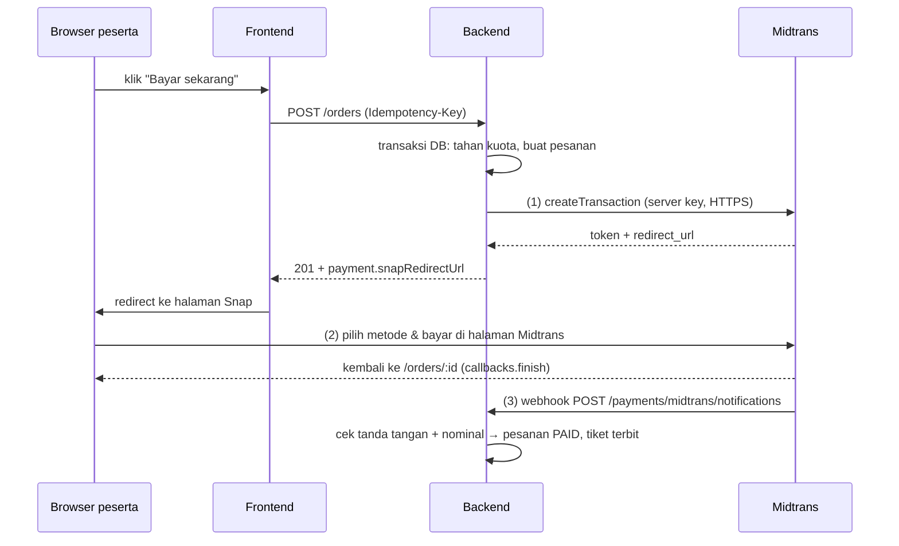
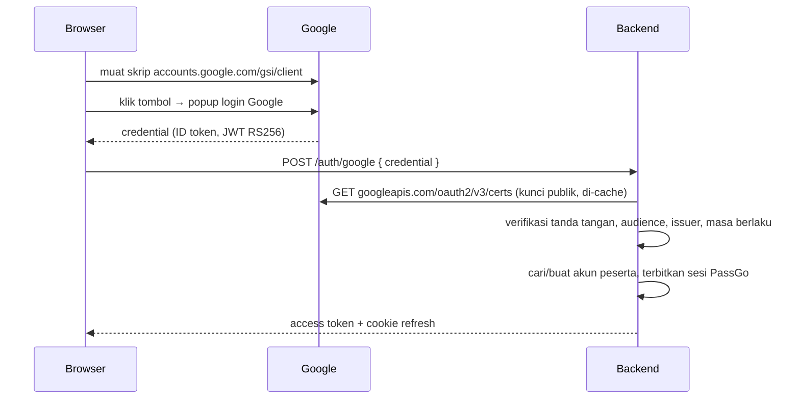
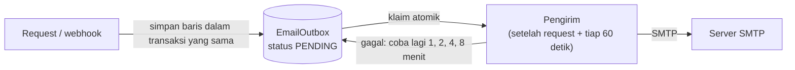

# Integrasi Layanan Pihak Ketiga

Dokumen ini menjelaskan **bagaimana PassGo menghubungi setiap layanan luar**: siapa yang memanggil, lewat apa,
dengan kredensial apa, urutan langkahnya, dan apa yang terjadi bila layanan itu gagal. Semua alur di bawah
diambil dari kode, dengan lokasi berkas disebutkan agar bisa dicek.

| Layanan | Dipakai untuk | Dihubungi oleh | Cara | Kredensial |
|---|---|---|---|---|
| [MongoDB Atlas](#1-mongodb-atlas) | Basis data | Backend | Driver MongoDB (Mongoose), TCP + TLS | `MONGODB_URI` |
| [Midtrans](#2-midtrans-snap) | Pembayaran | Backend ↔ Midtrans, browser → Midtrans | SDK `midtrans-client` (HTTPS) + webhook masuk | `MIDTRANS_SERVER_KEY` |
| [Google Identity Services](#3-google-identity-services-login-google) | Login dengan Google | Browser → Google, backend → Google | Skrip GIS di browser, JWKS lewat `fetch` | `GOOGLE_CLIENT_ID` (+ `NEXT_PUBLIC_GOOGLE_CLIENT_ID`) |
| [Supabase Storage](#4-supabase-storage) | Menyimpan poster | Backend, browser (baca saja) | SDK `@supabase/supabase-js` (HTTPS) | `SUPABASE_URL`, `SUPABASE_SERVICE_ROLE_KEY` |
| [SMTP](#5-smtp-email) | Mengirim email | Backend | `nodemailer` (SMTP + STARTTLS/TLS) | `SMTP_HOST`, `SMTP_USER`, `SMTP_PASS` |
| [Azure App Service](#6-azure-app-service--github-actions) | Hosting | GitHub Actions → Azure | `azure/webapps-deploy` (zip deploy) | Publish profile (GitHub Secret) |

Prinsip yang sama di semua integrasi:
- **Secret hanya di backend** (environment variable). Browser tidak pernah memegang server key Midtrans, kunci
  Supabase, atau password SMTP. Yang boleh ada di browser hanya nilai publik: Client ID Google.
- **Layanan luar yang gagal tidak boleh merusak data.** Setiap pemanggilan punya batas waktu, dan kegagalannya
  menghasilkan error yang jelas (`502`), rollback, atau percobaan ulang.
- **Data dari luar tidak dipercaya mentah-mentah**: webhook Midtrans dicek tanda tangan dan nominalnya, ID token
  Google dicek tanda tangan, penerima, dan penerbitnya.

---

## 1. MongoDB Atlas

**Fungsi:** menyimpan semua data (pengguna, acara, pesanan, tiket, dll.).
**Berkas:** `apps/backend/src/lib/database.ts`, `src/index.ts`, `server.ts`.

### Cara menghubungi
1. Saat server menyala, `connectDatabase()` memanggil `mongoose.connect(MONGODB_URI)`.
   URI berbentuk `mongodb+srv://<user>:<password>@<cluster>.mongodb.net/<db>`.
2. Mongoose membuka **connection pool** (TCP dengan TLS) ke replica set Atlas dan memakainya ulang untuk semua
   request. Koneksi tidak dibuka per request.
3. Di server long-running (`src/index.ts`, dipakai Azure) koneksi dibuka sekali sebelum `listen()`. Di Vercel
   (`server.ts`) koneksi dibuat saat request pertama lalu dipakai ulang selama instance fungsi hidup.
4. Alur kritis memakai **transaksi**: `mongoose.startSession()` → `session.withTransaction(async () => …)`.
   Contoh: membuat pesanan sekaligus memotong kuota; pembayaran lunas sekaligus menerbitkan tiket.

### Keamanan jaringan
- Atlas hanya menerima koneksi dari IP yang diizinkan di **Network Access** (IP keluar Azure App Service), plus
  username/password database di URI.
- `src/index.ts` memaksa DNS ke `8.8.8.8`/`1.1.1.1`, karena record SRV `mongodb+srv://` sering gagal di-*resolve*
  oleh DNS jaringan kampus/rumah.

### Bila gagal
- Server tidak mau menyala bila koneksi awal gagal (lebih baik gagal jelas daripada jalan setengah).
- `GET /api/v1/health/ready` menjawab `503` bila koneksi terputus, sehingga health check Azure tahu.
- Di Vercel, koneksi yang gagal dibuang agar request berikutnya mencoba lagi, dan request dijawab `503`.

---

## 2. Midtrans Snap

**Fungsi:** menerima pembayaran (QRIS, e-wallet, virtual account, kartu).
**Berkas:** `apps/backend/src/lib/midtrans.ts`, `src/services/order-service.ts`, `src/routes/payments.ts`,
`src/services/order-payment-service.ts`; frontend `app/(site)/checkout/[slug]/CheckoutForm.tsx`.
**Mode:** sandbox (`MIDTRANS_IS_PRODUCTION=false`), alamat `app.sandbox.midtrans.com` / `api.sandbox.midtrans.com`.

Ada **tiga arah komunikasi**:

### (1) Backend → Midtrans: membuat transaksi
1. Peserta membuat pesanan (`POST /orders`). Di dalam transaksi database, kuota ditahan dan pesanan dibuat
   dengan status `PENDING_PAYMENT`.
2. Backend membuat klien `new midtransClient.Snap({ isProduction, serverKey, clientKey })` lalu memanggil
   `createTransaction` dengan:
   - `transaction_details`: `order_id` = nomor pesanan acak `PG-XXXXXXXXXX`, `gross_amount` = total (integer Rupiah)
   - `item_details`: satu baris per tipe tiket (`id`, harga, jumlah, nama "Acara - Tipe tiket")
   - `customer_details`: nama, email, nomor HP pembeli
   - `expiry`: sama dengan batas tahan kuota (`ORDER_HOLD_MINUTES`, default 30 menit), agar Midtrans menolak
     pembayaran setelah kuota dilepas
   - `callbacks.finish`: `${FRONTEND_URL}/orders/<id>`, halaman tujuan setelah bayar
3. SDK mengirim `POST https://app.sandbox.midtrans.com/snap/v1/transactions` dengan header
   `Authorization: Basic base64(SERVER_KEY + ":")`.
4. Midtrans mengembalikan `token` dan `redirect_url`, yang disimpan di koleksi `Payment`.
5. **Batas waktu 10 detik.** Bila Midtrans tidak menjawab atau error, seluruh transaksi database dibatalkan
   (kuota kembali) dan klien menerima `502 payment-gateway-error`.
6. **Pesanan gratis** (total Rp0) tidak menghubungi Midtrans sama sekali: langsung `PAID` dan tiket terbit.

### (2) Browser → Midtrans: peserta membayar
- Frontend mengarahkan browser ke `payment.snapRedirectUrl` (halaman pembayaran Midtrans). Peserta memilih
  metode dan membayar **di situs Midtrans**, jadi data kartu tidak pernah melewati server PassGo.
- Bila halaman tertutup, tombol "Bayar" di halaman pesanan membuka `snapRedirectUrl` yang sama selama pesanan
  masih menunggu. Satu `order_id` hanya punya satu transaksi Snap.
- CSP frontend mengizinkan domain Midtrans (`*.midtrans.com`, `*.veritrans.co.id`, dan domain pendukung dari
  dokumentasi CSP Midtrans).

### (3) Midtrans → Backend: notifikasi pembayaran (webhook)
Midtrans memanggil **Payment Notification URL** yang didaftarkan di dashboard:
`https://passgo-api.azurewebsites.net/api/v1/payments/midtrans/notifications`. Endpoint ini publik (tanpa token),
jadi keasliannya dibuktikan dengan tanda tangan:

1. Body divalidasi Zod (`order_id`, `status_code`, `gross_amount`, `signature_key`, `transaction_status`, ...).
2. Backend menghitung `SHA-512(order_id + status_code + gross_amount + SERVER_KEY)` dan membandingkannya dengan
   `signature_key` memakai `crypto.timingSafeEqual` (perbandingan waktu-konstan). Tidak cocok → `403`.
3. Bila `transaction_status` adalah `settlement`, atau `capture` dengan `fraud_status` `accept`, backend
   memanggil `settleOrder`:
   - `gross_amount` harus sama dengan total pesanan (mencegah nominal yang diubah)
   - dalam satu transaksi database: pesanan `PAID`, `reservedCount` dipindah ke `soldCount`, tiket diterbitkan
     dengan kode acak, email e-tiket dimasukkan ke outbox
   - pembayaran yang datang **setelah** pesanan kedaluwarsa tetap diterima bila kuota masih ada (`ORDER_PAID_LATE`);
     bila kuota sudah habis, pesanan ditandai perlu refund
4. Outbox email langsung dikirim, lalu backend membalas `200` agar Midtrans berhenti mengirim ulang.
5. Pemrosesan **idempoten**: notifikasi yang sama dikirim dua kali tidak menerbitkan tiket dua kali, karena update
   pesanan bersyarat pada status saat itu.

### Sinkronisasi manual (bila webhook terlambat)
`POST /orders/:orderId/payment/sync` memanggil `snapClient().transaction.status(orderNumber)`
(`GET https://api.sandbox.midtrans.com/v2/<order_id>/status`, batas 5 detik), lalu menerapkan hasilnya:
lunas → `settleOrder`; `refund` → refund dicatat; `expire`/`cancel`/`deny` → pesanan dibatalkan dan kuota dilepas.
`404` dari Midtrans artinya peserta belum memilih metode bayar, jadi tidak ada yang diubah.

### Kedaluwarsa
Pesanan yang tidak dibayar sampai batas waktu dilepas oleh job berkala (`expireDueOrders`, tiap
`JOB_INTERVAL_SECONDS`) dan saat daftar pesanan dibuka. Kuota kembali tersedia.

### Pengujian lokal
Midtrans tidak bisa menembak `localhost`, jadi webhook diuji lewat tunnel (`ngrok http 3000`) yang URL-nya
didaftarkan sementara sebagai Payment Notification URL di dashboard sandbox. Pembayaran diselesaikan dengan
simulator sandbox Midtrans.

---

## 3. Google Identity Services (login Google)

**Fungsi:** "Lanjutkan dengan Google" di halaman masuk dan daftar.
**Berkas:** frontend `components/auth/GoogleButton.tsx`; backend `src/lib/google-id-token.ts`,
`src/routes/auth.ts` (`POST /auth/google`), `src/services/auth-service.ts` (`loginWithGoogle`).
**Protokol:** OpenID Connect, alur ID token (tanpa client secret dan tanpa redirect ke backend).

### Langkah di browser
1. `GoogleButton` memuat skrip resmi `https://accounts.google.com/gsi/client` (hanya bila
   `NEXT_PUBLIC_GOOGLE_CLIENT_ID` diisi; tanpa itu tombol tidak tampil).
2. `google.accounts.id.initialize({ client_id, ux_mode: "popup", callback })` lalu `renderButton(...)`
   menggambar tombol resmi Google (bahasa Indonesia).
3. Pengguna login di popup Google. Google mengembalikan `credential`: **ID token** (JWT) yang ditandatangani Google.
4. Frontend mengirimkannya ke `POST /api/v1/auth/google` lewat API client biasa.

### Langkah di backend
1. Membaca `kid` (ID kunci) dari header token.
2. Mengambil kunci publik Google dari `https://www.googleapis.com/oauth2/v3/certs` (JWKS) memakai `fetch`
   bawaan. Kunci di-**cache** sesuai header `Cache-Control` dari Google; bila `kid` tidak dikenal (Google baru
   merotasi kunci), JWKS diambil ulang sekali.
3. `jwt.verify(token, key, { algorithms: ["RS256"], audience: GOOGLE_CLIENT_ID, issuer: accounts.google.com })`.
   **Audience** memastikan token memang dibuat untuk aplikasi PassGo, bukan aplikasi lain.
4. Email dari Google harus `email_verified: true`.
5. Akun dicari berdasarkan email:
   - belum ada → dibuat akun **peserta** baru yang langsung terverifikasi, dengan password acak (hanya bisa login
     lewat Google atau setelah reset password)
   - sudah ada tapi belum verifikasi email → ditandai terverifikasi, password lama diganti acak, sesi lama dicabut
     (mencegah orang yang lebih dulu mendaftar dengan email korban mengambil alih akun)
   - akun nonaktif → ditolak
6. Backend menerbitkan **sesi PassGo sendiri** (access token + cookie refresh). Token Google tidak disimpan.

### Konfigurasi
- Google Cloud Console → OAuth Client ID tipe *Web application*, dengan **Authorized JavaScript origins**
  berisi `https://passgo-web.azurewebsites.net` dan `http://localhost:3001`.
- Client ID yang sama dipasang di backend (`GOOGLE_CLIENT_ID`) dan di build frontend
  (`NEXT_PUBLIC_GOOGLE_CLIENT_ID`, GitHub repository variable). Client ID bersifat publik; tidak ada client secret.
- CSP frontend mengizinkan `https://accounts.google.com/gsi/` untuk skrip, gaya, frame, dan koneksi.

### Bila gagal
JWKS tidak bisa diambil → `502 google-unavailable`; token tidak valid → `401 google-token-invalid`;
`GOOGLE_CLIENT_ID` kosong → `503 google-login-disabled`. Login dengan email/password tetap berjalan.
Endpoint ini memakai rate limit yang sama dengan login biasa.

---

## 4. Supabase Storage

**Fungsi:** menyimpan poster acara.
**Berkas:** `apps/backend/src/lib/storage.ts`, `src/services/event-service.ts`, `src/routes/events.ts`.

### Cara menghubungi
1. Saat backend menyala, bila `SUPABASE_URL` dan `SUPABASE_SERVICE_ROLE_KEY` terisi, dibuat klien
   `createClient(SUPABASE_URL, SUPABASE_SERVICE_ROLE_KEY)`. Bila tidak, poster disimpan di disk lokal `uploads/`
   (hanya untuk pengembangan).
2. Penyelenggara mengunggah poster: `PUT /api/v1/events/:eventId/poster` (multipart).
3. Sebelum menyentuh Supabase, backend memproses berkas di memori:
   - `multer`: maksimal 2 MB, tepat satu berkas
   - `sharp`: membaca format dari **isi** berkas (JPEG/PNG/WebP, selain itu `415`), cek ukuran minimal,
     lalu di-*re-encode* ke WebP kualitas 82 (sekaligus membuang EXIF/GPS)
4. Upload: `supabase.storage.from(SUPABASE_BUCKET).upload("events/<eventId>/<uuid>.webp", buffer,
   { contentType: "image/webp", cacheControl: "31536000", upsert: false })`, yaitu HTTPS ke REST API Storage
   dengan service role key di header `Authorization`.
5. URL publik diambil dengan `getPublicUrl(path)` dan disimpan di `Event.posterUrl`.
6. Poster lama dihapus dengan `remove([path])`. Kegagalan menghapus hanya dicatat di log, tidak menggagalkan request.

### Siapa membaca poster
**Browser langsung** mengambil gambar dari URL publik Supabase (`https://<proyek>.supabase.co/storage/v1/object/public/...`),
tanpa melewati backend. CSP frontend mengizinkan `https://*.supabase.co` di `img-src`.
Nama berkas memakai UUID baru setiap upload, sehingga cache satu tahun aman (poster baru = URL baru).

### Keamanan
- Service role key punya akses penuh, jadi **hanya** ada di backend.
- Bucket bersifat publik untuk baca saja; menulis hanya bisa lewat backend setelah otorisasi organizer.

### Bila gagal
Upload gagal → `502 storage-error`; data acara tidak berubah.

---

## 5. SMTP (email)

**Fungsi:** verifikasi email, reset password, e-tiket ber-QR, pemberitahuan pembatalan dan refund.
**Berkas:** `apps/backend/src/services/email-service.ts`, `src/services/email-templates.ts`, job di `src/index.ts`.
**Penyedia:** SMTP apa saja (mis. Gmail SMTP, Brevo); Mailpit untuk pengembangan lokal.

### Pola outbox: email tidak dikirim langsung

1. Aksi yang memicu email (daftar, lupa password, pembayaran lunas, acara batal) **menyimpan baris** ke koleksi
   `EmailOutbox` di dalam transaksi database yang sama. Jadi bila transaksinya batal, emailnya juga tidak ada;
   bila transaksinya berhasil, email pasti tercatat.
2. Pengirim berjalan di dua tempat: tepat setelah request terkait selesai (`flushEmailOutbox`, agar email
   verifikasi langsung datang) dan job berkala tiap `JOB_INTERVAL_SECONDS` (default 60 detik).
3. Setiap baris **diklaim atomik** (`findOneAndUpdate` dari `PENDING` ke `PROCESSING`), sehingga dua instance
   atau dua job tidak mengirim email yang sama. Baris yang macet di `PROCESSING` lebih dari 10 menit diklaim ulang.

### Cara menghubungi server SMTP
1. Transport dibuat sekali: `nodemailer.createTransport({ host: SMTP_HOST, port: SMTP_PORT (587),
   secure: SMTP_SECURE atau port 465, auth: { user: SMTP_USER, pass: SMTP_PASS } })`.
   Port 587 memakai STARTTLS; port 465 memakai TLS langsung.
2. Template dirender (`renderEmail`) menjadi subjek, teks, dan HTML. Untuk e-tiket, QR tiap tiket dibuat sebagai
   PNG dengan `qrcode.toBuffer` dan dilampirkan **inline** (`cid:qr-<id>`), sehingga tampil di badan email tanpa
   mengambil gambar dari internet.
3. `transport.sendMail({ from: MAIL_FROM, to, subject, text, html, attachments })`.
4. Berhasil → `SENT`, dan status email tiket di pesanan diperbarui.
   Gagal → kembali `PENDING` dengan jeda bertambah (1, 2, 4, 8 menit), maksimal 5 percobaan lalu `FAILED`.
   Peserta bisa meminta kirim ulang e-tiket (maks 3×/jam per pesanan).

### Tanpa SMTP
Bila `SMTP_HOST` kosong (pengembangan/test), email hanya dicetak ke log (`[email:dry-run]`) lalu ditandai
terkirim, agar antrean tidak menumpuk.

---

## 6. Azure App Service & GitHub Actions

**Fungsi:** hosting frontend dan backend, deploy otomatis.
**Berkas:** `.github/workflows/deploy-frontend.yml`, `deploy-backend.yml`; panduan `docs/deploy-azure.md`.

### Deploy (GitHub → Azure)
1. Push ke `main` yang mengubah `apps/frontend/**` atau `apps/backend/**` memicu workflow yang sesuai.
2. Runner GitHub menjalankan `npm ci`, pengecekan (typecheck, unit test / lint), lalu build:
   - backend: `tsc` ke `dist/`, lalu dependency produksi dipasang di folder paket
   - frontend: `next build` (standalone) dengan `BACKEND_URL` dan `NEXT_PUBLIC_GOOGLE_CLIENT_ID` dari
     repository variables
3. `azure/webapps-deploy@v3` mengunggah paket sebagai zip ke Kudu (`<app>.scm.azurewebsites.net`) memakai
   **publish profile** (GitHub Secret, berisi kredensial deploy). `clean: true` menghapus isi folder lama dulu.
4. Azure me-*restart* container dan menjalankan startup command
   (`node dist/index.js` / `HOSTNAME=0.0.0.0 node apps/frontend/server.js`).

### Lalu lintas saat berjalan
1. Browser → `https://passgo-web.azurewebsites.net` (HTTPS diterminasi oleh front end Azure).
2. Next.js meneruskan `/api/v1/*` dan `/uploads/*` ke `https://passgo-api.azurewebsites.net` (server-ke-server),
   sehingga browser hanya melihat satu origin dan cookie `SameSite=Strict` bekerja.
3. Di depan backend ada dua proxy (front end Azure untuk web → Next → front end Azure untuk API), jadi backend
   memakai `TRUST_PROXY=2` dan membuang port dari `X-Forwarded-For` (Azure mengirim `ip:port`) agar rate limit
   dan log audit mencatat IP klien yang benar.
4. Konfigurasi dan secret diberikan lewat **App Settings** Azure (environment variable), bukan berkas.

---

## Ringkasan kredensial

| Variabel | Letak | Rahasia? | Untuk |
|---|---|---|---|
| `MONGODB_URI` | Backend | Ya | Koneksi Atlas |
| `MIDTRANS_SERVER_KEY` | Backend | Ya | Membuat transaksi + memverifikasi webhook |
| `MIDTRANS_CLIENT_KEY` | Backend | Tidak (publik di Midtrans) | Klien Snap |
| `MIDTRANS_IS_PRODUCTION` | Backend | Tidak | Sandbox atau produksi |
| `GOOGLE_CLIENT_ID` / `NEXT_PUBLIC_GOOGLE_CLIENT_ID` | Backend / build frontend | Tidak | Audience ID token, tombol Google |
| `SUPABASE_URL`, `SUPABASE_BUCKET` | Backend | Tidak | Alamat penyimpanan |
| `SUPABASE_SERVICE_ROLE_KEY` | Backend | **Ya, akses penuh** | Upload & hapus poster |
| `SMTP_HOST`, `SMTP_PORT`, `SMTP_USER`, `MAIL_FROM` | Backend | Tidak/sebagian | Server email |
| `SMTP_PASS` | Backend | Ya | Login SMTP |
| Publish profile | GitHub Secrets | Ya | Deploy ke Azure |
| `BACKEND_URL` | GitHub variable (build frontend) | Tidak | Tujuan proxy API |

Semua rahasia hanya ada di `.env` lokal (tidak di-commit), App Settings Azure, dan GitHub Secrets.
